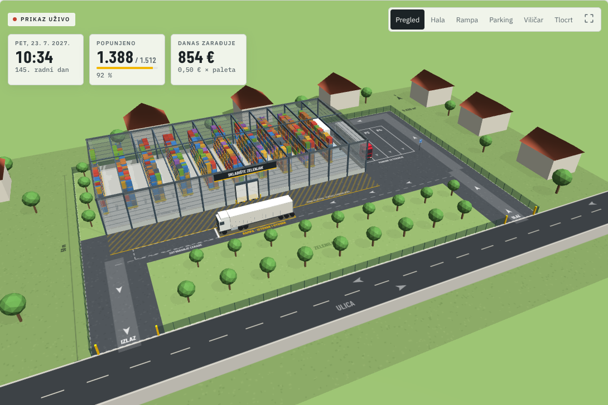

# Skladište Zelenjak

Interaktivna 3D simulacija paletnog skladišta na Zelenjaku (Zeleni brijeg, Sisak). Prikazuje parcelu od 5.220 m² s halom od 1.620 m² i 1.512 paletnih mjesta, jednom rampom i parkingom za šlepere koji čekaju termin. Viličar slaže palete po regalima, a zarada dolazi od skladištenja i manipulacije. Napravljena u Babylon.js i TypeScriptu, po uzoru na [Checkout Lab](https://github.com/klindic/automated-cashiers).



## Objavljena simulacija

[Otvori simulaciju na GitHub Pages](https://klindic.github.io/pallet-warehouse/).

Svaki push na `main` pokreće testove, produkcijski build i objavu kroz GitHub Actions. U postavkama repozitorija pod **Settings → Pages** izvor mora biti **GitHub Actions**.

## Što se vidi

- **Parcela 90 × 58 m.** Hala 60 × 27 m stoji uz sjeverni rub. Šleperi ulaze s istočnih vrata i izlaze na zapadna, pa se nigdje ne voze unatrag.
- **Jedna rampa.** Šleper stoji paralelno s halom, a otvorena cerada gleda u vrata od 5 m. Istovaruje se ili utovaruje uvijek samo jedan šleper.
- **Parking za čekanje.** Četiri mjesta uz istočni zid hale (P1–P4). Tu stoji tko je došao prije termina ili čeka da se rampa oslobodi. Vozač na parkingu otvori ceradu, pa na rampi odmah kreće rad.
- **Zona za zatvaranje cerade.** Gotov šleper se odmakne prema izlazu i tamo zatvara ceradu, da sljedeći odmah uđe na rampu.
- **Hala.** 18 redova regala × 7 polja × 3 EUR palete × 4 razine = **1.512 paletnih mjesta**. Između redova je 9 prolaza po 3,8 m za protuteži viličar. Svi prolazi izlaze u hodnik uz vrata, gdje je 58 podnih mjesta za brzi istovar i za robu pripremljenu za odvoz. U istočnom pojasu su ured s WC-om i punjač viličara.
- **Zelenilo.** Asfalt je samo gdje voze šleperi i viličar. Zelenilo s drvoredom uz ulicu pokriva 27 % parcele, a GUP traži najmanje 20 %.
- **Razmještaj robe.** Roba koja kratko ostaje ide bliže vratima i na niže razine. Roba koja ostaje dugo ide dublje i više. Palete iste pošiljke drže se u istom prolazu.

Kamera ima šest pogleda: pregled, hala, rampa, parking, viličar i tlocrt. Povlačenjem se okreće, a kotačić ili dva prsta približavaju.

Hala je od limenih sendvič panela s antracit opšavom. Klizač **Zidovi** mijenja koliko se kroz lim vidi unutra (0–100 %, zadano 45 %), a prekidač **Krov** dodaje krov. Ispod 3D prikaza su i kontrole vremena: pokreni ili pauziraj, brzina od 1 minute do 1 tjedna u sekundi, preskakanje na sljedeći dan ili mjesec i ponovni početak.

Sučelje je složeno najprije za mobitel: na uskom ekranu prvo dolaze 3D prikaz, brojke i kontrole, zatim zarada, raspored dana i postavke. Na računalu su postavke lijevo od prikaza.

## Kako teče dan

1. U **06:30** dispečer (mi) slaže termine na rampi: prvo odvoze robe kojoj je istekao dogovoreni rok, zatim nove dovoze, naizmjence. Gablec od 30 minuta stavlja između dva šlepera nakon 11:00. Zahtjev za dovoz odbija se ako za robu nema mjesta ili ako ne stane u radni dan. Odvoz koji ne stane pomiče se na sljedeći radni dan.
2. Većina šlepera dođe u termin. Oko 15 % dođe 30–150 minuta ranije i čeka na parkingu, oko 12 % kasni 20–90 minuta, a oko 3 % ne dođe.
3. Rampa uzima šleper s najranijim terminom među onima koji su već tu. Ako netko kasni, na rampu ide sljedeći koji čeka. Ako su svi poranili, raniji šleper se ubaci samo ako stigne završiti prije sljedećeg termina.
4. Viličar istovaruje ili utovaruje paletu po paletu. Na šleperu skenira naljepnicu i pregleda paletu, zatim vozi kroz pojas ispred hale, kroz vrata i hodnikom do mjesta u regalu. Prosječni ciklus je oko 85 s po paleti. Kad netko čeka red, istovar ide na pod uz vrata, a u regale se sprema poslije.
5. Na kraju svakog šlepera skladištar s vozačem riješi papire: otpremnicu, CMR, potpis i pečat (3 min).
6. Između šlepera viličar sprema robu s poda u regale i unaprijed izvlači robu za sljedeći odvoz. Zadnjih 90 minuta dana priprema robu za jutarnje odvoze.
7. Viličarist sjedne na 5 minuta nakon otprilike 2 h rada i ima 30 minuta gableca.

Potražnja raste po S-krivulji: na početku je oko 0,8 upita za dovoz dnevno, a nakon oko 60 radnih dana (oko 3 mjeseca) oko 10. To je zadani rast **Brz**; u postavkama se može usporiti na **Normalan** (120 radnih dana) ili **Spor** (200 radnih dana). Radi se 8 h dnevno, od ponedjeljka do petka. Noći i vikendi se preskaču.

## Zarada

Svake ponoći naplaćuje se **broj paleta na skladištu × cijena po paleti po danu** (zadano 0,50 €), i to za svaki kalendarski dan, pa i vikendom. Uz to se uvijek naplaćuje **manipulacija** po paleti na ulazu i na izlazu (zadano 2 €). Mjesečni troškovi raspoređuju se po danima. Zadano je 4.730 € mjesečno: plaća skladištara koji radi na viličaru (1.600 € neto, što uz stopu poreza na dohodak od 21,6 % u Sisku firmu stoji oko 2.730 €), leasing viličara 700 € i ostali troškovi 1.300 € (struja, osiguranje, komunalna naknada, knjigovođa, održavanje). Rata kredita i plaće ostale dvojice ortaka nisu uključene. Svaka stavka mijenja se posebno u postavkama.

Ploča **Zarada** prikazuje današnji prihod, prihod ovog mjeseca, ukupni prihod i ono što ostane nakon troškova. Tu je i projekcija iz zadnjih 30 dana i dan od kojeg je prihod pokrio troškove. **CSV po danima** izvozi sve dnevne brojke.

Uz zadane postavke posao se razvija ovako:

| Mjesec | Popunjenost | Prihod | Od toga manipulacija | Nakon troškova | Viličar radi | Šlepera dnevno |
| --- | --- | --- | --- | --- | --- | --- |
| 1. | 20 % | 6.600 € | 1.900 € | 1.700 € | 1,4 h | 1,9 |
| 2. | 79 % | 23.400 € | 6.700 € | 19.000 € | 5,4 h | 7,0 |
| 3.–12. | 79–93 % | 27.700–29.800 € | 8.300–9.500 € | 22.900–25.200 € | 6,5–7,0 h | 8,4–9,0 |

Prihod pokrije sve troškove od početka već na kraju prvog mjeseca. Prva godina završava s oko 320.000 € prihoda i oko 263.000 € viška. Iz tog viška plaća se rata kredita za zemljište i halu.

Na punom skladištu viličar efektivno radi oko 6,8 h dnevno (dani od oko 5,8 do 7,5 h). Uz pauze i gablec od oko 37 minuta to je puno radno vrijeme. Prekovremeno je prosječno oko 6 minuta dnevno, kad šleper kasni pa ga treba dovršiti. Usko grlo je rampa s jednim viličarom: oko pola upita za dovoz se odbije jer nema termina. Drugi viličar s još jednim skladištarom popuni skladište do kraja (98 %), ali donosi samo oko 3.500 € mjesečno više, a druga plaća i drugi leasing koštaju oko 3.400 €.

## Pretpostavke i pojednostavljenja

- Sve brojke su procjene koje se mijenjaju u postavkama. Ništa nije kalibrirano mjerenjima.
- Šleper nosi do 32 EUR palete, dvije poprijeko. Viličar ih uzima sa strane jednu po jednu, kao da su sve dohvatljive.
- Rampa je prizemna, za bočni istovar. Rampe s vratima u razini poda prikolice nisu modelirane.
- Klijenti su izmišljeni i označeni slovima A–H po vrsti robe.
- Ovo nije projekt hale. Visinu, statiku, protupožarne uvjete, zelenilo iz GUP-a i priključke mora riješiti ovlašteni projektant. Za ovu halu treba parcela od oko 5.200 m², gotovo dvostruko veća od tri parcele s ~3.000 m².

## Pokretanje

Potreban je Node.js 22+.

```sh
npm ci
npm run dev -- --host 127.0.0.1
```

```sh
npm test -- --run
npm run build
npm run build:pages   # isti build kao na GitHub Pages (/pallet-warehouse/)
```

## Struktura

- `src/simulation/`: čista simulacijska jezgra bez prikaza (`engine.ts`), tlocrt i mjere (`layout.ts`), konfiguracija, generator slučajnih brojeva i testovi.
- `src/scene/`: Babylon scena, tlocrt nacrtan kao tekstura tla, modeli šlepera i viličara.
- `src/main.ts`, `src/ui.ts`, `src/analytics.ts`, `src/styles.css`: hrvatsko sučelje, ploče, grafovi i CSV.

Isti seed i iste postavke daju istu potražnju i iste dogovorene termine. Brzina prikaza može promijeniti sitne detalje u minutama, ali ne i sliku poslovanja.
